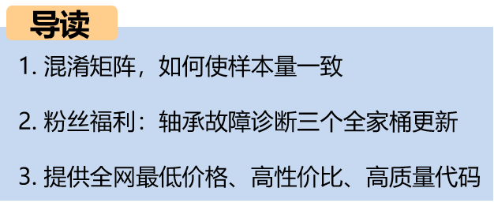
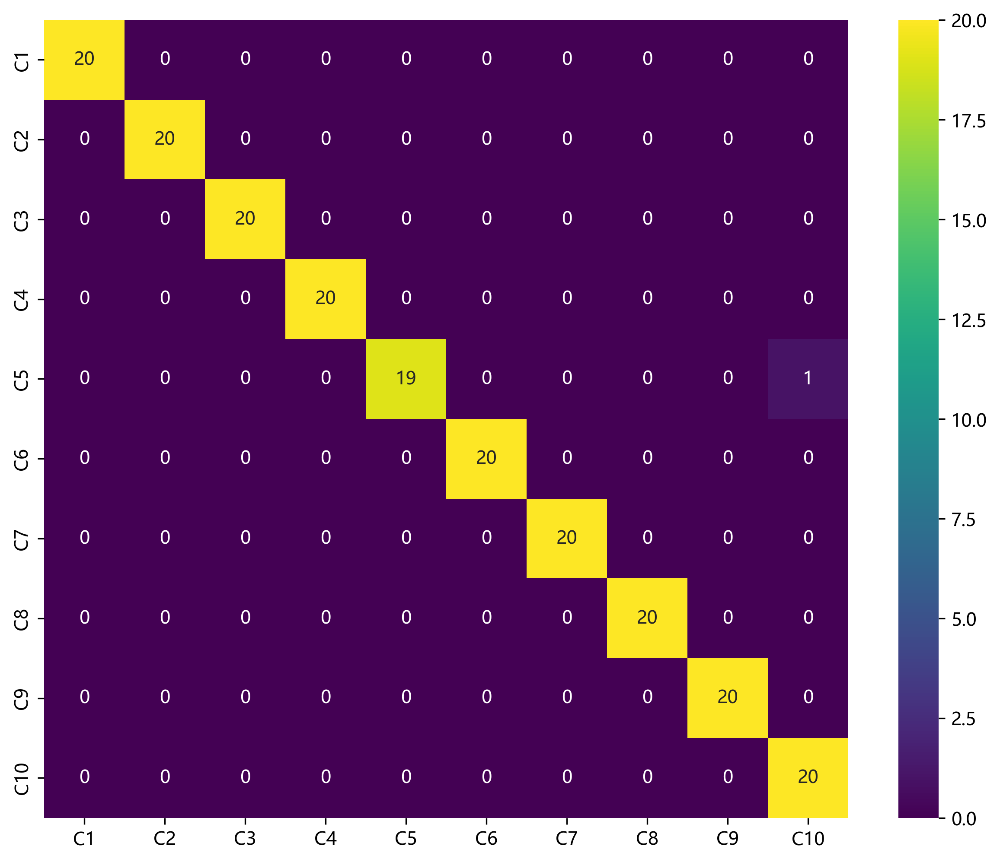
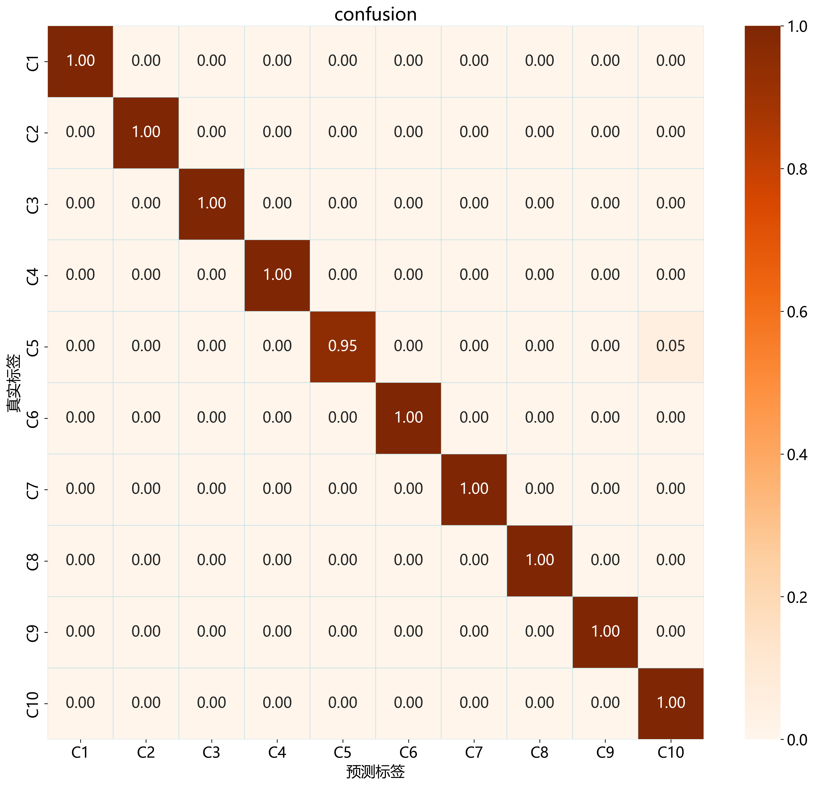
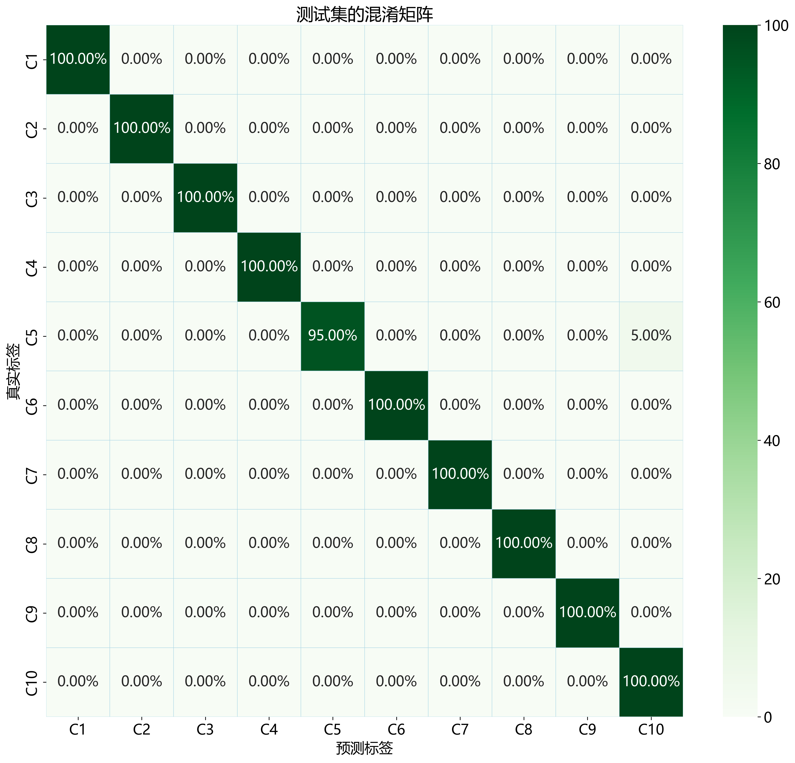
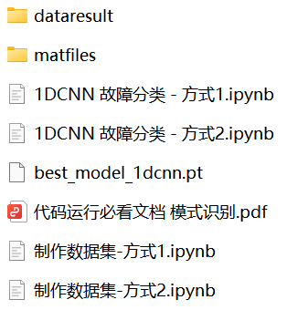
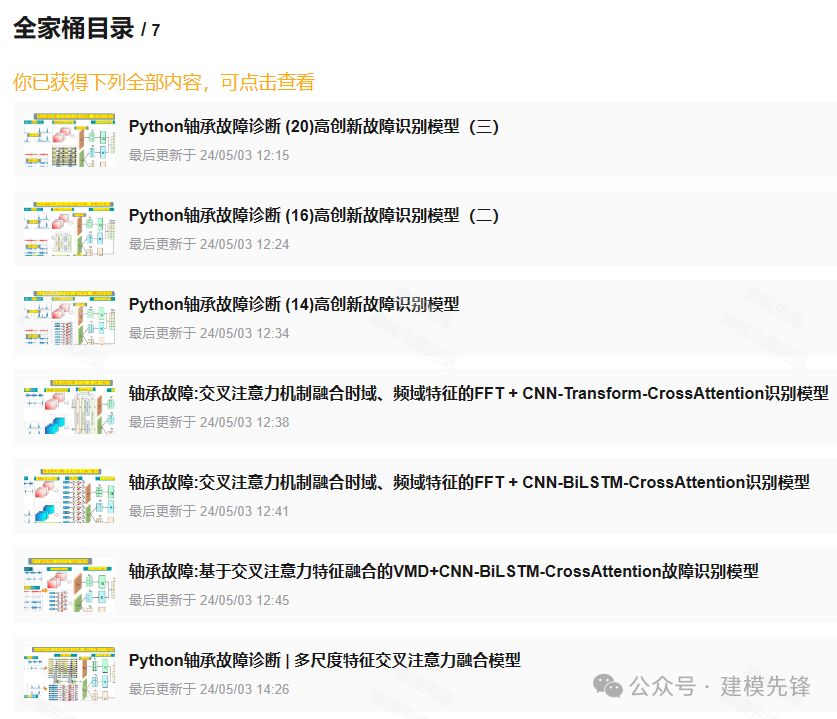

# Fault Diagnosis Model Evaluation - Confusion Matrix, How to Make the Sample Size Consistent

\n        \n      \n        \n      \n        \n      \n        \n  
Preface
Behind the scenes, fans have inquired about confusion matrices within classification models. How can we set relevant parameters to ensure consistent sample sizes? In this issue, we will focus on confusion matrices and explain how to use the 1DCNN classification model from Case Western Reserve University (CWRU) for demonstration!
\n        \n  
● Dataset: Bearing Data from Case Western Reserve University (CWRU)
● Environment Framework: Python 3.9, PyTorch 2.1 and above can be run.
● Model Experiment: 1DCNN
● Usage Object: Beginners, those requiring papers.
● Code Guarantee: The code comments are detailed and ready to run.
● Supplementary documents: detailed tutorials on environmental configuration and installation, as well as documentation on models and parameters.
Firstly, it should be declared:
The confusion matrix is used to evaluate the performance of classification models, especially in multi-class classification tasks. It displays the correspondence between true and predicted classes. The sample sizes for each class do not need to be equal. Especially in our previous models, we often use public datasets that are balanced. By randomly shuffling the samples, then splitting into training, validation, and test sets, there may be minor discrepancies in the sample sizes for different classes in the final test set's confusion matrix, but these differences are negligible. Particularly, as the overall sample size increases, such class-wise discrepancies have a minimal impact.
During the submission process, reviewers do not have such requirements. However, it is still necessary to clarify the parameters related to sample size and how they are influenced among each other. Certainly, having a consistent number of samples for each class in the confusion matrix also has the following advantages: Firstly, it facilitates the calculation of the sample size for the test set. Secondly, it is more aesthetically pleasing; Thirdly, it can reflect a balanced dataset.
Question 1: Which parameters determine the sample size for fault signals?
The sample size of the fault signal is determined by the following three parameters:
Dataset Sequence Length
Sample Length (Window Value)
Overlap Rate
1. Dataset Sequence Length
For example, in our classification task at Western Reserve University (CWRU), we truncate the overall dataset to ensure that all categories have the same number of sampling points. When the sample length (window value) and overlap rate are fixed, the longer the dataset sequence, the greater the sample volume, and vice versa.
It is important to note that this truncation value is not fixed; generally, we cut based on the length of the least sampling point for each fault type to ensure that there are equal sampling points across different categories. If a certain sample volume needs to be designed, it is acceptable to discard some samples. For example, if the overall data sequence has 12000 sampling points and a sliding window and overlap rate are fixed, we must generate x x samples. After calculation, the total sampling points required are 10000. Discarding the last 2000 sampling points is also acceptable (it means the dataset may not be used entirely, but a portion can still be used).
2. Sample Length (Window Value) and Overlap Rate
There are many ways to split datasets, and the step size varies as well. Below, we will divide the data according to fixed parameters:
Step size window_step: 1024 (each sample length is 1024 points)
Overlap rate overlap_ratio: 0.5 (the overlap rate between adjacent samples)
How do you understand the overlap rate? Here's an example:
How to calculate the total sample volume?
To calculate the number of samples that can be generated under the conditions of given sequence length, sample window size, and sample overlap rate, we need to follow these steps:
First, define the parameters:
- Sequence length: L = 120000
- Sample window size: W = 1024
- Overlap rate: overlap = 0.5
- Stride: stride = W * (1 - overlap) = 1024 * (1 - 0.5) = 512
Step two: Calculate the number of samples:
The formula is:
In our example:
Each category generates 233 samples, and there are ten categories in total, generating 2330 samples! In our previous models, if we divide the training set, validation set, and test set as 7:2:1, the division numbers would be as follows:
Question two: How to ensure that the confusion matrix class sample quantities are consistent?
1. Other parameters affecting sample quantities:
\tIf we follow the above division method, the evaluation results might look like this:
Test set samples are 224, and the sample quantities of each category are not consistent. Some students may ask, why does the test set have only 224 samples? This brings up the question of batch_size and drop_last=True. When setting these two parameters, the training process uses a batch size. If the total number of samples cannot be evenly divided by the batch size, the last batch will have fewer samples than the batch size. Typically, to simplify the training process, the last incomplete batch may be discarded because some deep learning frameworks, by default, ignore samples that cannot form complete batches.
If we don't want to discard incomplete batch samples, we can set the dataset loader to drop_last=False. When drop_last=False, the data loader (such as PyTorch's DataLoader) will include the last incomplete batch during training. This means that even if the last batch has fewer samples than the set batch size (batch size), it will still be used for training. This could potentially affect the model training in the following ways:
Advantages: All available data is utilized for training, preventing any wastage of samples. This is particularly important when the amount of data itself is limited, as each sample may be valuable for the model's learning.
Disadvantages:
Incomplete batches can lead to less stable gradient updates for that particular batch, especially in operations that rely on batch statistics such as Batch Normalization. This is because the mean and variance are calculated based on fewer samples, potentially introducing some bias.
However, for most models and tasks, these minor differences generally do not significantly affect the training results, especially when the amount of data is large.
Therefore, the setting of `batch_size` and `drop_last` also affects the final test set sample size to a certain extent (it is reasonable to set `drop_last=False` especially when all samples are desired).
So now consider parameter settings in different situations:
Assuming two parameters are fixed:
- Sample window size: W = 1024
- Overlap rate: overlap = 0.5
Situation one: drop_last=False (not considering batch size)
To achieve the goal of consistent confusion matrix class sample quantities in the test set, the test set sample quantity must be an integer multiple of the number of classes.
We will infer the parameters affecting the sample quantity by first assuming the test set sample quantity, then to backtrack from problem one. There are 10 classification tasks, assuming the test set sample quantity is 20! (total test set sample quantity 200), then because according to 7:2:1 division of training set, validation set, test set, the test set proportion is 0.1, so the total sample quantity for each class is 200 samples, at this time the window value is 1024, the overlap rate is 0.5, according to the formula:
So the overall sequence length for each class sample is (200-1)*512+1024=102912, then set the sequence length:
Overall sample quantity:
2000 samples, and it is important to note that the sample division should ensure that the number of samples in each category within the test set is consistent. This requires stratified sampling.
Method 1:
Using the data splitting function provided by the sklearn package in Python.
Method 2:
During the creation of the dataset, perform stratified sampling.
Final test set confusion matrix:
Next time, we will introduce tutorials on calculating sample sizes and confusion matrices in various scenarios.
The relevant code and model experiments are as follows:
(1) 27 Bearing Fault Diagnosis Models | The most cost-effective all-in-one set across the network.
\t27 Bearing Fault Diagnosis Models | The most cost-effective all-in-one set across the network.
(2) Bearing Fault Diagnosis - Innovative Model Full Set
\tFault Diagnosis | Innovative Model Update: Diagnostic Model Based on SSA-CNN-Transformer
(3) Bearing Faults—Cross Attention Innovation Model Family Kit
\tPython Bearing Fault Diagnosis | Multi-Scale Feature Cross Attention Fusion Model
Previously Featured Content:
Python Bearing Fault Diagnosis | From Beginner to Publication
Python Bearing Fault Diagnosis (14) High-Innovation Fault Identification Model
| SCI 1 Zone High-Innovation Bearing Fault Diagnosis Model!
High-Innovation Bearing Fault Diagnosis Model Based on GADF+Swin-CNN-GAM
Attention Magic Mod | Superb Bearing Fault Diagnosis Model!
Python Bearing Fault Diagnosis (19) - Innovation in Diagnosis Model Based on Transformer-BiLSTM
Bearing Fault Diagnosis Model Based on K-NN + GCN
27 Bearing Fault Diagnosis Models | The Most Affordable Full Set Online
| Bearing Fault Diagnosis Model Based on KAN and Convolutional Kernels
Time-frequency chart update | Bearing fault diagnosis based on visual top conference + time-frequency chart
Fault Diagnosis | Code Explanation + Live Classes, currently in progress!
Fault Diagnosis | Innovative Model Update: Diagnostic Model Based on SSA-CNN-Transformer
Rapid Publication Paper | Parallel Fault Diagnosis Model Based on 2D-SWinTransformer + 1D-CNN-SENet
KAN, KAN Convolutional Integration with Attention Mechanism!
Parallel Fault Diagnosis Model Based on 2D-SwinTransformer + BiGRU-GlobalAttention
Positional Encoding Demystified | A Comprehensive Guide to Transformer's Positional Encoding
Resource Sharing | Intelligent Fault Diagnosis and Prediction Based on Graph Neural Networks
Innovation Point | Fault Diagnosis Model Based on Fast Fourier Transform Convolution (FFC)
Code Open Source! | Fault Diagnosis in Varying Conditions via Domain Adversarial Graph Convolution Networks
Over Thirty Open Source Datasets | No More Worries About Datasets for Fault Diagnosis!
Fault Diagnosis | An essential tool for graduate students and second-year students to publish papers!!!
Superior! Top Conference Innovation Integration! Parallel Classification Network Based on 2D-SWinTransformer
Multimodality - Fault Diagnosis | Large Core Convolution Opens a New Era in Vision!
End
\t2. Friends who like this can click the follow button, give the article a "like", share it on WeChat Moments or discuss groups.

## Images

<!-- PAYMENT_BLOCK -->

## Get this dataset

- Payment link (Stripe): [Buy now](https://buy.stripe.com/3cs8yP7sY87d0vu9AB)
- Payment QR code: 

<!-- /PAYMENT_BLOCK -->
